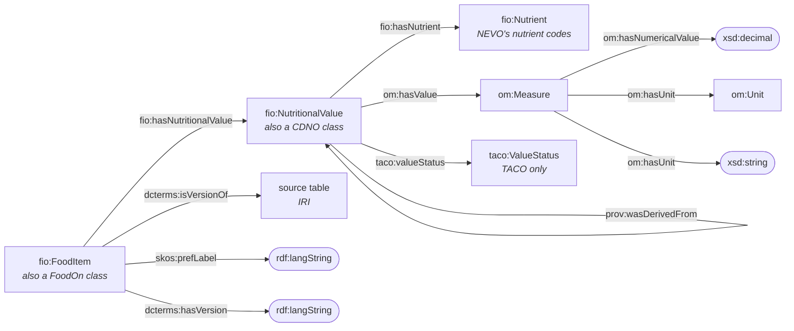
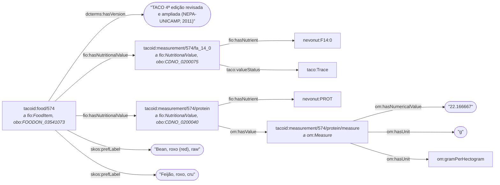

# TACO in NICE-Food: data, namespaces, URIs, schema and an example

Generated on 2026-11-19 by `python scripts/describe_structure.py` from Fuseki's `nicefood` dataset, where TACO's NICE-Food export and NICE-Food's NEVO graphs are loaded together with FoodOn, and checked by `python verification/structure_check.py`. NEVO is described by its structure and by counts only, not by food names or values.

TACO, the Brazilian food composition table, is written in the pattern NICE-Food uses for NEVO, so that the two tables sit in one knowledge graph and the same queries answer for both. This file lists what the graph uses, so that we can agree on a common structure: which namespaces and URIs stand for which things.

## 1. Files to open

No code has to be run: the RDF files are on GitHub.

| File | What it holds |
| --- | --- |
| [docs/taco-in-nice-food/files/knowledge-graph/taco_nice_food.ttl](https://github.com/Victoria125/taco-rdf/blob/main/docs/taco-in-nice-food/files/knowledge-graph/taco_nice_food.ttl) | TACO in the NICE-Food pattern, all foods |
| [docs/taco-in-nice-food/files/knowledge-graph/example_food_574.ttl](https://github.com/Victoria125/taco-rdf/blob/main/docs/taco-in-nice-food/files/knowledge-graph/example_food_574.ttl) | one food of it, to read |
| [ontology/taco.ttl](https://github.com/Victoria125/taco-rdf/blob/main/ontology/taco.ttl) | TACO's vocabulary, on top of FIO |
| [ontology/imports/foodon-module.ttl](https://github.com/Victoria125/taco-rdf/blob/main/ontology/imports/foodon-module.ttl) | the FoodOn classes the graph uses, release 2026-09-20 |
| [ontology/imports/cdno-module.ttl](https://github.com/Victoria125/taco-rdf/blob/main/ontology/imports/cdno-module.ttl) | the CDNO classes the graph uses, release 2026-06-10 |
| [data/alignment/taco_nevo_nutrients.csv](https://github.com/Victoria125/taco-rdf/blob/main/data/alignment/taco_nevo_nutrients.csv) | each TACO nutrient and its NEVO nutrient code |
| [data/alignment/nevo_cdno_completion.csv](https://github.com/Victoria125/taco-rdf/blob/main/data/alignment/nevo_cdno_completion.csv) | CDNO classes TACO's mapping offers NEVO's values |
| [analysis/nutrient_definitions.md](https://github.com/Victoria125/taco-rdf/blob/main/analysis/nutrient_definitions.md) | whether each shared nutrient code is the same quantity in both tables |
| [analysis/foodon_term_requests.md](https://github.com/Victoria125/taco-rdf/blob/main/analysis/foodon_term_requests.md) | FoodOn term-search leads for unresolved TACO foods |

## 2. The data in numbers

|  | TACO | NEVO in NICE-Food |
| --- | --- | --- |
| food items | 597 | 1,673 |
| with a FoodOn type | 597 | 1,300 |
| nutritional values | 21,720 | 187,275 |
| values with a CDNO class | 18,131 | 110,480 |
| values with a number | 18,134 | 187,275 |
| values with a status instead | 3,586 | 0 |
| calculated values (PROV) | 570 | 0 |
| nutrients | 68 | 136 |
| CDNO classes | 54 | 75 |

NEVO in NICE-Food holds the 2021 and 2023 releases. A value "with a status instead" is a TACO cell with no number: a trace, not applicable, or under re-evaluation. The calculated values are TACO's available carbohydrate, its carbohydrate minus its dietary fibre.

## 3. Namespaces

| Prefix | Namespace | What it is | TACO | NEVO |
| --- | --- | --- | --- | --- |
| `tacoid` | `https://w3id.org/taco-rdf/id/` | TACO's instances: foods, values, measures | yes |  |
| `taco` | `https://w3id.org/taco-rdf/vocab#` | TACO's vocabulary (ontology/taco.ttl) | yes |  |
| `nevo21` | `https://data.rivm.nl/data/nvip/bigfood/nevo21/` | NEVO 2021 food items and measures |  | yes |
| `nevo23` | `https://data.rivm.nl/data/nvip/bigfood/nevo23/` | NEVO 2023 food items and measures |  | yes |
| `nevonut` | `https://data.rivm.nl/data/nvip/bigfood/nevo/nutrient#` | NEVO's nutrients (and NEVO's values) |  | yes |
| `fio` | `http://www.foodvoc.org/resource/fio#` | NICE-Food's vocabulary: food item, nutritional value | yes | yes |
| `obo` | `http://purl.obolibrary.org/obo/` | FoodOn (FOODON_) and CDNO (CDNO_) classes | yes | yes |
| `om` | `http://www.ontology-of-units-of-measure.org/resource/om-2/` | Ontology of units of Measure 2.0 | yes | yes |
| `skos` | `http://www.w3.org/2004/02/skos/core#` | SKOS, for names (prefLabel) | yes | yes |
| `dcterms` | `http://purl.org/dc/terms/` | Dublin Core terms: source table, identifier, version | yes | yes |
| `prov` | `http://www.w3.org/ns/prov#` | PROV: where a calculated value came from | yes |  |

## 4. URIs

The URIs each table mints for its food items, nutritional values and measures. The last column counts how many URIs of each kind follow the pattern.

| Table | Kind | Pattern | Example | Follow it |
| --- | --- | --- | --- | --- |
| TACO | food item | `tacoid:food/{TACO number}` | `tacoid:food/1` | 597 of 597 |
| TACO | nutritional value | `tacoid:measurement/{TACO number}/{nutrient key}` | `tacoid:measurement/1/ash` | 21,720 of 21,720 |
| TACO | measure | `tacoid:measurement/{TACO number}/{nutrient key}/measure` | `tacoid:measurement/1/ash/measure` | 18,134 of 18,134 |
| NEVO | food item | `nevo21:nevocode#{NEVO code} (or nevo23:)` | `nevo21:nevocode#1` | 1,673 of 1,673 |
| NEVO | nutritional value | `nevonut:{nutrient code and identifier}` | `nevonut:ALC14F05` | 187,275 of 187,275 |
| NEVO | measure | `nevo21:value#{identifier} (or nevo23:)` | `nevo21:value#ALC16F2C` | 187,275 of 187,275 |

NEVO names nutrients with its own URIs (`nevonut:PROT` for protein). TACO uses NEVO's URI wherever NEVO has the same nutrient: 41 of its 68 nutrients, 18,056 of its 21,720 values (`data/alignment/taco_nevo_nutrients.csv`). For the other 27 nutrients, 3,664 values, TACO uses its own URI (for example `tacoid:nutrient/manganese`): NEVO has no manganese, no amino acid but tryptophan and no code for total carbohydrate, and has some fatty acids only as cis and trans, or n-3 and n-6, apart. For 6 of those fatty acids TACO's own INFOODS tagnames or names give the form NEVO has a code for, so they could take NEVO's code; and a shared code is not always the same quantity: TACO calculates carbohydrate and energy another way than NEVO ([analysis/nutrient_definitions.md](https://github.com/Victoria125/taco-rdf/blob/main/analysis/nutrient_definitions.md)). Food types are FoodOn classes (`obo:FOODON_…`), nutrient classes are CDNO classes (`obo:CDNO_…`), and units are OM units. In NEVO's graph, `nevonut:PROT` is a `fio:Nutrient`.

## 5. Schema: classes and properties only

Boxes are classes; rounded boxes are datatypes. A food item is also an instance of a FoodOn class, and a nutritional value of a CDNO class (`rdf:type`).

| On a | Property | TACO uses it | NEVO uses it |
| --- | --- | --- | --- |
| food item | `dcterms:hasVersion` | 597 | 1,673 |
| food item | `dcterms:identifier` | 597 |  |
| food item | `dcterms:isVersionOf` | 597 | 1,673 |
| food item | `fio:hasNevoCode21` |  | 1,657 |
| food item | `fio:hasNevoCode23` |  | 16 |
| food item | `fio:hasNutritionalValue` | 21,720 | 187,275 |
| food item | `rdf:type` | 1,194 | 2,981 |
| food item | `skos:prefLabel` | 1,194 | 3,346 |
| nutritional value | `dcterms:description` | 570 |  |
| nutritional value | `fio:hasNutrient` | 21,720 | 187,275 |
| nutritional value | `om:hasValue` | 18,134 | 187,275 |
| nutritional value | `prov:wasDerivedFrom` | 1,140 |  |
| nutritional value | `rdf:type` | 39,851 | 297,755 |
| nutritional value | `taco:valueStatus` | 3,586 |  |
| measure | `om:hasNumericalValue` | 18,134 | 187,275 |
| measure | `om:hasUnit` | 35,790 | 348,307 |
| measure | `rdf:type` | 18,134 | 187,275 |

## 6. Example: instances only

TACO food 574, raw red beans: its protein value with its measure, and a value TACO reports as a trace, which has a status and no measure. Each box is an instance and lists its classes; rounded boxes are literals.

The same food as RDF: [example_food_574.ttl](https://github.com/Victoria125/taco-rdf/blob/main/docs/taco-in-nice-food/files/knowledge-graph/example_food_574.ttl).

## 7. Same and different, TACO and NEVO

- Both tables use: `dcterms:hasVersion`, `dcterms:isVersionOf`, `fio:hasNutritionalValue`, `rdf:type`, `skos:prefLabel`, `fio:hasNutrient`, `om:hasValue`, `om:hasNumericalValue`, `om:hasUnit`.
- Only TACO uses: `dcterms:identifier`, `dcterms:description`, `prov:wasDerivedFrom`, `taco:valueStatus`.
- Only NEVO uses: `fio:hasNevoCode21`, `fio:hasNevoCode23`: NEVO's own food codes, where TACO gives its food number with `dcterms:identifier`. Every other property NEVO uses, TACO uses too.
- Units, as `om:hasUnit` values (an OM unit and the same unit as a string):

| Unit | TACO | NEVO |
| --- | --- | --- |
| "g" | 9,831 | 126,355 |
| "kJ" | 591 | 1,685 |
| "kcal" | 591 | 1,685 |
| "mg" | 6,643 | 31,307 |
| "µg" | 478 | 26,243 |
| om:gramPerHectogram | 9,831 | 126,355 |
| om:kilocaloriePerHectogram | 591 | 1,685 |
| om:kilojoulePerHectogram | 591 | 1,685 |
| om:milligramPerHectogram | 6,643 | 31,307 |

- 8 NEVO food items are typed with classes other than FoodOn's (obo:CHEBI, obo:NCBITaxon, obo:PO, obo:UBERON); TACO types foods only with FoodOn classes, and none with a class FoodOn places under an organism or plant.

## 8. NICE-Food's datasets, read from its code

What each notebook of NICE-Food's pipeline ([rivm-syso/nicekg_processing](https://github.com/rivm-syso/nicekg_processing), commit `d3d1edb`) mints and uses, read from its code. TACO is added for comparison.

| Dataset | Mints URIs under | Types with | Properties it adds |
| --- | --- | --- | --- |
| KAP | `https://data.rivm.nl/data/nvip/bigfood/kap/parameter#` `https://data.rivm.nl/data/nvip/bigfood/kap/value#` | `om:Measure`, `om:Unit`, `sosa:FeatureOfInterest`, `sosa:Observation`, `sosa:Sample`, `ssn:Property` | `dcterms:isVersionOf`, `dcterms:issued`, `kap_param:hasFoodex2code`, `kap_param:hasId`, `kap_param:hasKapName`, `om:hasNumericalValue`, `om:hasUnit`, `rdfs:label`, `rdfs:subClassOf`, `saref:hasMeasurement`, `saref:hasProperty`, `saref:isMeasuredIn`, `saref:isMeasurementOf`, `saref:isPropertyOf`, `saref:relatesToMeasurement`, `saref:relatesToProperty`, `schema:countryOfOrigin`, `skos:prefLabel` |
| LCA | `https://data.rivm.nl/data/nvip/bigfood/lca24/impact#` `https://data.rivm.nl/data/nvip/bigfood/nevo23/nevocode#` | `fio:FoodItem`, `fio:Impact`, `om:Measure` | `dcterms:hasVersion`, `dcterms:isVersionOf`, `fio:hasImpact`, `fio:hasNevoCode23`, `fio:hasSystemBoundary`, `om:hasNumericalValue`, `om:hasUnit`, `om:hasValue`, `rdfs:comment`, `rdfs:label`, `skos:closeMatch` |
| LEDA | `https://data.rivm.nl/data/nvip/bigfood/leda/ingcode#` `https://data.rivm.nl/data/nvip/bigfood/leda/ledaprodcode#` `https://data.rivm.nl/data/nvip/bigfood/leda/nut#` `https://data.rivm.nl/data/nvip/bigfood/leda/value#` `https://data.rivm.nl/data/nvip/bigfood/nevo/nutrient#` `https://data.rivm.nl/data/nvip/bigfood/nevo23/nevocode#` | `fio:FoodItem`, `fio:FoodProduct`, `fio:Nutrient`, `fio:NutritionalValue`, `om:Measure` | `fio:hasCategory`, `fio:hasLedaCode`, `fio:hasNevoCode23`, `fio:hasNutrient`, `fio:hasNutritionalValue`, `fobi:_00424`, `fobi:_00425`, `om:hasNumericalValue`, `om:hasUnit`, `om:hasValue`, `rdfs:label`, `skos:broader` |
| NEVO | `https://data.rivm.nl/data/nvip/bigfood/nevo/foodgroup#` `https://data.rivm.nl/data/nvip/bigfood/nevo/nutrient#` `https://data.rivm.nl/data/nvip/bigfood/nevo21/nevocode#` `https://data.rivm.nl/data/nvip/bigfood/nevo21/value#` `https://data.rivm.nl/data/nvip/bigfood/nevo23/nevocode#` `https://data.rivm.nl/data/nvip/bigfood/nevo23/value#` | `fio:FoodItem`, `fio:Nutrient`, `fio:NutritionalValue`, `om:Measure` | `dcterms:hasVersion`, `dcterms:isVersionOf`, `fio:hasNevoCode21`, `fio:hasNevoCode23`, `fio:hasNutrient`, `fio:hasNutritionalValue`, `om:hasNumericalValue`, `om:hasUnit`, `om:hasValue`, `rdfs:label`, `skos:prefLabel` |
| TACO | `https://w3id.org/taco-rdf/id/` | `fio:FoodItem`, `fio:NutritionalValue`, `om:Measure` | `dcterms:hasVersion`, `dcterms:isVersionOf`, `fio:hasNutritionalValue`, `rdf:type`, `skos:prefLabel`, `fio:hasNutrient`, `om:hasValue`, `om:hasNumericalValue`, `om:hasUnit`, `dcterms:identifier`, `dcterms:description`, `prov:wasDerivedFrom`, `taco:valueStatus` |

NEVO, LEDA, LCA and TACO describe food items with `fio:FoodItem` and their numbers with `om:Measure`, `om:hasValue`, `om:hasNumericalValue` and `om:hasUnit`; NEVO, LEDA and TACO also share `fio:NutritionalValue` and `fio:hasNutrient`. KAP describes its measurements with SOSA and SAREF.

## 9. TACO-RDF's own graph

The converter first builds TACO-RDF's own graph (181,482 triples), with TACO's vocabulary and QUDT units: 21,150 `taco:NutrientMeasurement`, 742 `taco:AlignmentAssertion`, 597 `taco:Food`, 67 `taco:Nutrient`, 15 `taco:FoodGroup`. It keeps alignment provenance and corrections. The NICE-Food export above is derived from it and uses the same URIs for foods and values; it adds the calculated available carbohydrate.

## 10. More foods in common

Today 135 TACO foods and 155 NEVO food items share a FoodOn class (114 classes), so the same queries find them as the same kind of food. Another 117 TACO foods and 200 NEVO food items are one subclass step from a class of the other table, so a query for the more general class finds both.

Among the foods still without a type, the candidates for review include a class the other table already uses for 0 TACO foods (0 from the food's own name) and 191 NEVO food items (62 from the name). If reviewers accept those candidates, these foods join the shared ones. They are upper bounds: reviewers decide.

## 11. Points to agree on

1. Each table mints its own URIs under its own domain. TACO uses one pattern for foods, values and measures (section 4); NEVO's values sit in the same namespace as its nutrients. Do we want a common pattern for values and measures?
2. Nutrients: TACO reuses NEVO's nutrient URIs where NEVO has the nutrient, so NICE-Food's queries work unchanged; it names the nutrients NEVO lacks under its own domain. If every value also carries a CDNO class, queries can select by CDNO and each table can keep its own nutrient codes. Which should the shared queries use? A shared code is not always the same quantity: TACO calculates carbohydrate and energy another way than NEVO (`analysis/nutrient_definitions.md`).
3. CDNO on every value: 110,480 of 187,275 NEVO values and 18,131 of 21,720 TACO values have a CDNO class. TACO's mapping offers classes for NEVO's total fat and tryptophan (`data/alignment/nevo_cdno_completion.csv`).
4. Values without a number: TACO states trace, not applicable or under re-evaluation with `taco:valueStatus`. Should NICE-Food have a common term for this?
5. Calculated values: TACO records what a value was calculated from with `prov:wasDerivedFrom`.
6. Units: both tables give an OM unit and a string for g, mg, kcal and kJ, and only a string for µg. Should µg get an OM unit too?
7. Food types: `rdf:type` to a FoodOn class, from a fixed release (FoodOn 2026-09-20, CDNO 2026-06-10). Should the shared structure fix the releases, and allow classes outside FoodOn?
8. Measurements: NEVO, LEDA, LCA and TACO use FIO with OM; KAP uses SOSA and SAREF. Is one pattern for measurements part of the common structure?

## 12. Towards a minimal interoperability profile

A Minimal Interoperability Profile ([MIP](https://github.com/fensel/MIP)) is the smallest ontology-based model, 10 to 15 classes and properties, that lets datasets exchange data, reusing established ontologies and checked with SHACL. The structure TACO and NEVO share has 15 terms: the classes `fio:FoodItem`, a FoodOn class, `fio:NutritionalValue`, a CDNO class, `fio:Nutrient`, `om:Measure`, `om:Unit`, and the properties `fio:hasNutritionalValue`, `fio:hasNutrient`, `om:hasValue`, `om:hasNumericalValue`, `om:hasUnit`, `dcterms:isVersionOf`, `dcterms:hasVersion`, `skos:prefLabel`. NEVO, LEDA and LCA already use its core. A draft profile could be these terms with SHACL shapes; TACO-RDF already checks NEVO's graph with SHACL shapes for this pattern (`shapes/nice-food/nevo-shapes.ttl`), and TACO's export follows the same pattern, so TACO can be the first table checked against the profile.

## 13. Where this meets work in progress

- NEVO's representation: the CDNO classes TACO's mapping offers NEVO (point 3), and a sheet with FoodOn suggestions for NEVO's 373 food items without a type, among them suggestions from similar typed TACO foods.
- Matching food terms to FoodOn: 0 currently untyped TACO foods have no usable candidate in the historical search ([analysis/foodon_term_requests.md](https://github.com/Victoria125/taco-rdf/blob/main/analysis/foodon_term_requests.md)). A failed candidate search does not establish an ontology gap. The decompose-then-match approach of [rivm-syso/matching-complex-food-terms](https://github.com/rivm-syso/matching-complex-food-terms) can help investigate unresolved composite dishes or opportunities for more specific terms.
